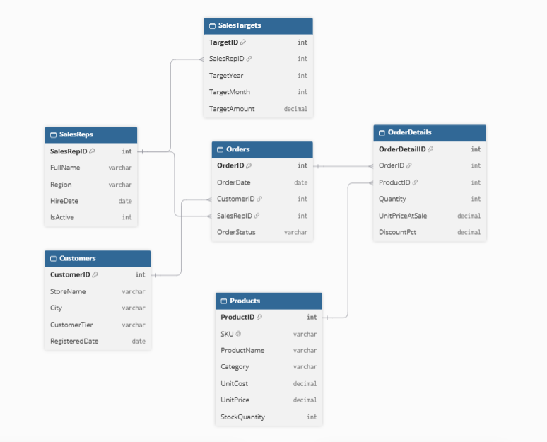
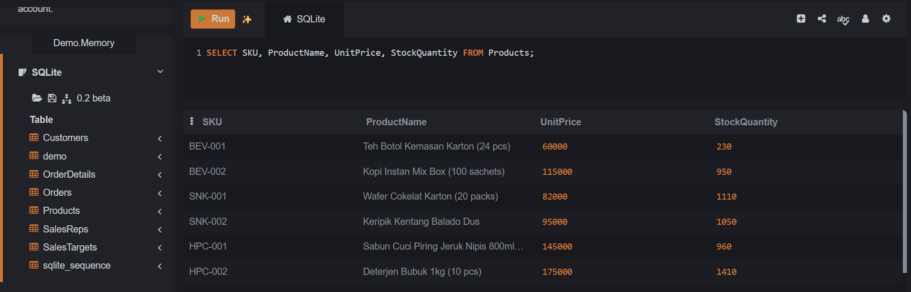
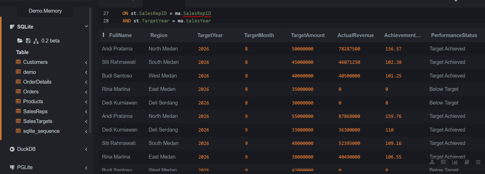
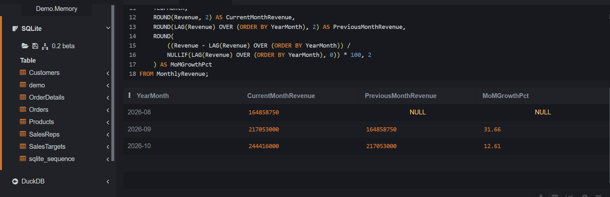

# 📊 Sales & Distribution Analytics Database (SQL)

A relational database design and business intelligence analytics project built to simulate B2B FMCG distribution operations, automated inventory management, and sales team performance tracking.

## 🎯 Project Overview
Drawing from real-world experience managing regional sales teams and monthly revenue targets, this database solves common operational challenges in distribution tracking:
- **Normalized Relational Schema (3NF):** Prevents data redundancy across 6 interconnected tables (`SalesReps`, `SalesTargets`, `Customers`, `Products`, `Orders`, `OrderDetails`).
- **Automated Inventory Control:** Implements database triggers to validate stock availability prior to order entry and automatically deduct warehouse inventory upon order confirmation.
- **Executive Business Analytics:** Delivers 8 intermediate-to-advanced SQL queries utilizing **CTEs**, **Window Functions (`LAG`, `DENSE_RANK`)**, **Pareto Product Share**, and **Month-over-Month (MoM) Growth** metrics.

---

## 🗂️ Database Architecture (ERD)

### Repository Structure
- `01_schema_and_triggers.sql` — DDL scripts for table creation, primary/foreign key constraints, indexing, and automated stock-deduction triggers.
- `02_seed_data.sql` — Realistic multi-month B2B transaction dataset across multiple sales regions and customer tiers.
- `03_analytics_queries.sql` — 8 business intelligence queries covering revenue, gross profit, target attainment, MoM growth, Pareto product share, and inventory alerts.

---

## 🚀 Key Results & Query Previews

### 1. Automated Inventory Trigger Verification
Upon inserting order line items, the trigger automatically validates and deducts stock quantities from the initial `2,000` units per SKU:

### 2. Monthly Sales Target Attainment (CTE & Conditional Logic)
Compares actual completed order revenue against assigned monthly targets per sales representative:

### 3. Month-over-Month (MoM) Revenue Growth (`LAG` Window Function)
Tracks monthly revenue progression and percentage growth across Q3–Q4:

---

## 🛠️ Tech Stack & Concepts Demonstrated
- **Database Engines:** SQLite & Microsoft SQL Server (T-SQL compatible)
- **Core Concepts:** Relational Modeling, Foreign Keys & Check Constraints, Indexing, Triggers, Common Table Expressions (CTEs), Window Functions (`LAG`, `DENSE_RANK`, `OVER`), and Aggregations.

---

## 👤 Author
**Teguh Christianto Daeli**  
*Transitioning into Software Development & Data/Database Engineering*  
- **LinkedIn:** [https://www.linkedin.com/in/teguhdaeli/]
- **Email:** daeliteguh@gmail.com
